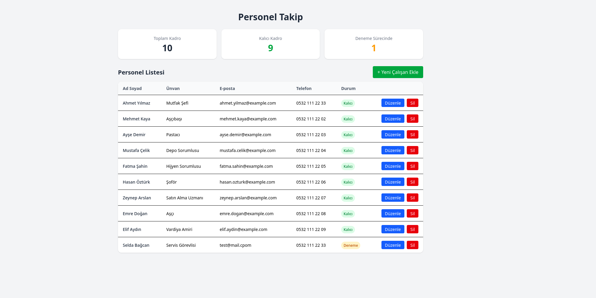
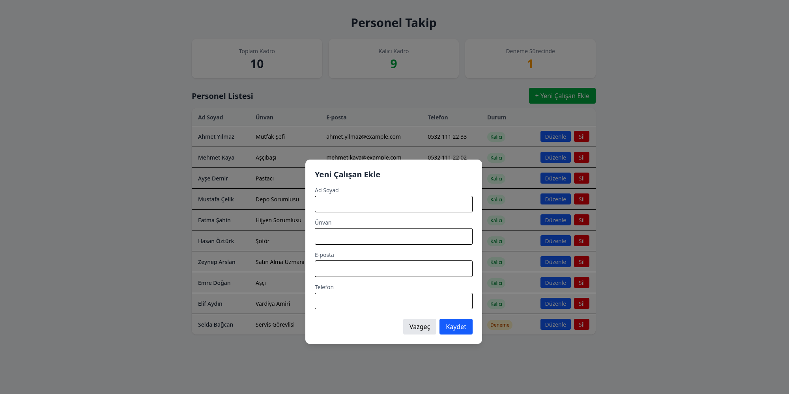
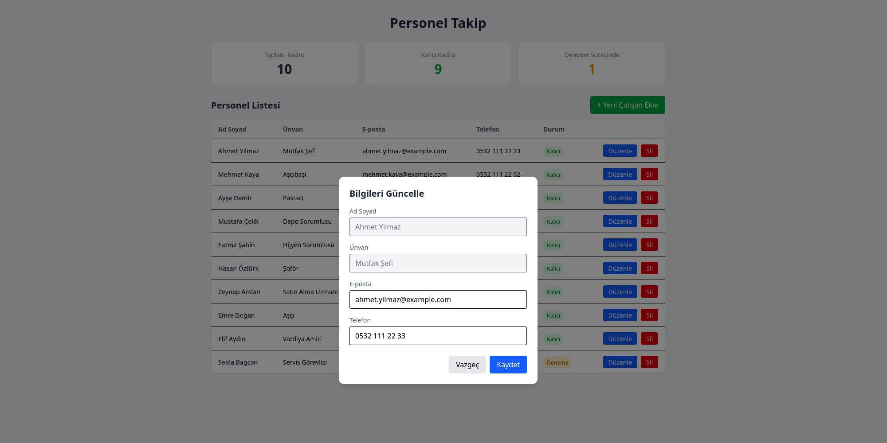
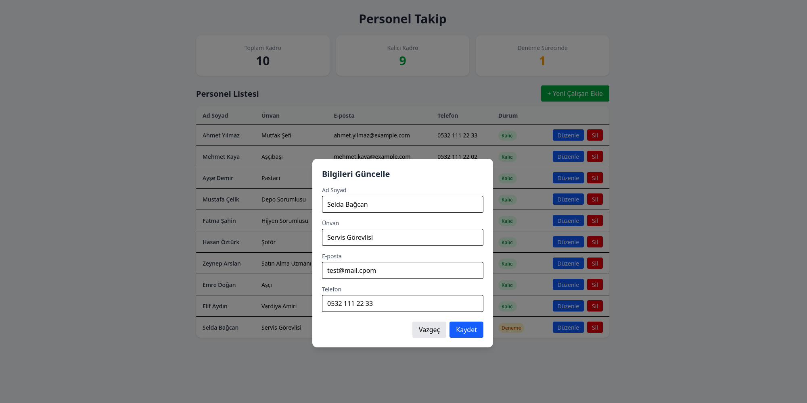
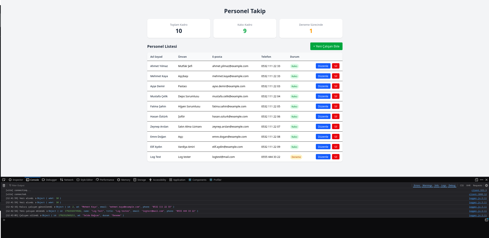

# Personel Takip

Bir catering firması için geliştirilmiş, tek ekranlı bir personel takip uygulaması. Kalıcı kadro bir API'den (mock veri) çekilir, deneme sürecindeki çalışanlar ise tarayıcıda LocalStorage'da tutulur.

**Canlı site:** NETLIFY_LINKI

## Ekran Görüntüleri

### Ana ekran

Üstte toplam, kalıcı ve deneme sürecindeki kadro sayıları, altında personel listesi yer alır.



### Yeni çalışan ekleme

"Yeni Çalışan Ekle" butonu ile açılan modal. Eklenen kişi deneme kadrosu olarak LocalStorage'a kaydedilir.



### Kalıcı kadro güncelleme

Kalıcı kadroda yalnızca e-posta ve telefon bilgisi düzenlenebilir, ad ve ünvan kilitlidir.



### Deneme kadrosu güncelleme

Deneme sürecindeki çalışanların tüm bilgileri düzenlenebilir.



### Loglama

Veri çekme, ekleme, güncelleme ve silme işlemleri tarayıcı konsoluna yazılır.



## Proje Senaryosu

Catering sektöründe kadro yapısı iki farklı gruptan oluşur. Kalıcı kadro (mutfak, depo, yönetim vb.) uzun süre aynı kalır ve değişimi azdır. Servis elemanı rolünde ise personel sirkülasyonu çok yüksektir: bu role sürekli yeni insanlar gelir, bir süre çalışır ve çeşitli sebeplerle işten ayrılır.

Uygulama bu ayrımı yansıtacak şekilde kurgulandı:

- **Kalıcı kadro** değişmeyen bir kayıt kaynağı gibi ele alındığı için bir API'den (mock veri) çekilir. Bu kayıtlarda yalnızca iletişim bilgileri gibi küçük güncellemeler yapılır.
- **Deneme sürecindeki / geçici kadro** sık değiştiği için ekleme, güncelleme ve silme işlemleri tarayıcının LocalStorage alanında yönetilir.

### Gelecek Planı

Bu proje, Software Persona mesleki yeterlilik eğitimi kapsamında eğitim teslimi için bu şekilde kurgulanmıştır. İleriye dönük gerçek bir kullanım hedeflenmektedir ve uygulamayı evdeki Raspberry Pi 4 üzerine kurmayı planlıyorum.

Sonraki aşamada proje, Node.js kullanan otomatik bir sisteme evrilecektir. Aynı eğitimde geliştirdiğim Node.js/Express tabanlı projedeki ([Görev ve Proje Yönetim Sistemi REST API](https://github.com/alpayacr0/task-management-api)) yaklaşım temel alınarak:

- Veriler veritabanı yerine JSON dosyasında tutulmaya devam edecek,
- Bir Node.js (Express) sunucusu bu JSON dosyasını okuyup yazacak,
- Deneme sürecindeki çalışanlar, 2 aylık deneme süresi sonunda sunucu tarafından otomatik olarak kalıcı kadro JSON dosyasına aktarılacaktır.

## Özellikler

- **Özet kartları:** Toplam kadro, kalıcı kadro ve deneme sürecindeki kadro sayıları
- **Listeleme:** Tüm çalışanların tablo halinde görüntülenmesi, durum etiketiyle (Kalıcı / Deneme)
- **Ekleme:** Yeni çalışan modal üzerinden eklenir (deneme kadrosu olarak LocalStorage'a kaydedilir)
- **Güncelleme:** Kalıcı kadroda e-posta ve telefon, deneme kadrosunda tüm bilgiler düzenlenebilir
- **Silme:** Onay penceresiyle çalışan silinir
- **Loglama:** Veri çekme, ekleme, güncelleme ve silme işlemleri tarayıcı konsoluna yazılır (`F12` → Console)

## Kullanılan Teknolojiler

- React 19
- Vite
- Tailwind CSS 4
- Axios
- LocalStorage

## Proje Yapısı

```
src/
├── Components/   (StatCard, StaffTable, PersonModal)
├── Pages/        (Home.jsx)
├── utils/        (logger.js)
├── App.jsx
└── main.jsx
public/
└── staff.json    (mock API verisi)
screenshots/      (README ekran görüntüleri)
```

## Verilerin Tutulması

- Kalıcı kadro `public/staff.json` dosyasından Axios ile çekilir.
- Kalıcı kadroda yapılan güncellemeler ve silmeler LocalStorage'da (`staffOverrides`) saklanır.
- Deneme sürecindeki çalışanlar LocalStorage'da (`trialStaff`) saklanır.

## Kurulum

```bash
git clone https://github.com/alpayacr0/personel-takip.git
cd personel-takip
npm install
npm run dev
```

Üretim derlemesi için:

```bash
npm run build
npm run preview
```
